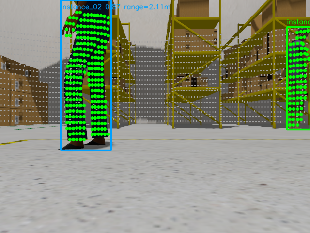
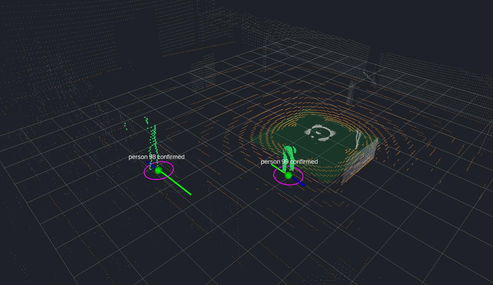

# Mobin — 포트폴리오 수록 원고와 이미지 해설

2026-09-15 · Perception 및 Tracking 직무 중심 · **수록 원고 갱신: 성과 / 추적 설계 / 검증 방법**

이번 갱신은 아래 원고와 면접 보조 자료에 해당한다. LaTeX·PDF·Canva에 이번 문구를 반영한 상태는 아니다. 아래쪽의 페이지 번호와 반영 기록은 2026-09-07 당시 자료를 설명한다.

## 최종 수록 원고

### 성과

- ROS 2 및 Gazebo 기반 카메라와 3D LiDAR 사람 인식 및 추적 시스템 개인 설계 및 구현(C++/Python).
- 사람과 배경의 거리 후보가 함께 검출되면 사람 관측까지 버리던 문제 개선. 최근접 유효 후보의 LiDAR 점 수가 다른 유효 후보 합계의 **2배 이상**이면 채택하도록 수정하여, 동일 저장 입력 997개 평가에서 미검출(FN) 570→3건으로 **99.5% 감소**, F1 **15.51→91.07%** 개선.
- 영상에서 검출한 사람 영역을 전달하는 과정에서 배경이 추가되던 오류 수정. YOLO 원본 mask를 보존하여 구멍 및 분리 영역 재현 사례의 잘못 추가된 영역 **49·10→각각 0픽셀**.

FN은 위치 평가에서 실제 사람과 대응하지 못한 관측 수다. 위 개선율은 거리 후보 선택 조건만 바꾼 동일 입력 비교이며, 추적 알고리즘 각각의 개선율은 아니다. ID switch는 **8→8회**로 감소하지 않았다.

### 추적 설계

- **Constant Velocity Kalman Filter**로 사람의 평면 위치와 속도를 추정하고, 다음 관측 시각의 위치 및 불확실성 예측.
- **Mahalanobis gate와 절대거리 제한**으로 예측 위치에서 지나치게 벗어난 관측을 대응 후보에서 제외하고, **Hungarian 알고리즘**으로 전체 대응 비용이 최소가 되도록 기존 사람 ID와 새 관측을 일대일 연결.
- 최근 관측 이력에 따라 tentative / confirmed / lost 상태 관리. 기본 설정은 최근 최대 5회 갱신 중 3회 이상 대응 시 confirmed이며, 일시적으로 관측을 놓치면 예측 상태를 유지.

`confirmed`는 관측 반복 조건을 충족한 상태이며 실제 사람임을 보증하지 않는다. 현재는 외형 기반 사람 재식별을 사용하지 않으므로 교차 및 장기 가림에서 ID 변경이 남는다.

### 검증 방법

- **직접 만든 센서 입력으로 원인별 검증:** 160×120 사람 mask와 좌표를 지정한 LiDAR 점군을 생성해 실제 ROS C++ 연결 노드에 입력. 원본 mask 보존, 같은 영상 위치에 겹친 앞뒤 측정값, 이웃 픽셀, 벽만 관측되는 경우 등 **10사례**의 출력 및 실패 조건 확인.
- **깊이 필터의 검증 규모:** 센서 설치 위치 차이로 카메라에서는 사람에 가려진 벽이 LiDAR에는 보일 수 있어, 같은 영상 픽셀에 투영된 뒤쪽 측정값을 제외. **사람 3점(2m)과 벽 6점(5m)을 배치한 1사례**에서 벽 6점 제거 및 사람 3점 보존 확인. 다양한 실환경에 대한 성공률은 측정하지 않음.
- **Gazebo 통합 검증:** 사람 3명, 고정 seed 42, 정지 로봇의 별도 60초 실행에서 누적 정답 330관측에 대해 TP 310 / FP 64 / FN 20, F1 **88.07%**, ID switch **15회** 기록.
- **회귀 검증 기록:** C++ 테스트 실행 파일 5개와 Python 테스트 27개 통과. ROS 합성 10사례는 별도이며, 알려진 오채택을 재현하는 사례도 포함.

합성 시험은 mask와 점군을 직접 넣는 시험으로, Gazebo 센서 생성·YOLO 추론·추적기의 통합 성능을 평가하지 않는다. Gazebo 실행은 위 동일 입력 전후 비교와 조건이 달라 개선율로 연결하지 않는다.

**보조 자료:** [추적 설계, 모의 입력 생성 방법, 계산 예시 및 면접 답변](portfolio_tracking_interview.md). 아래의 기존 이미지 해설과 TP/FP/FN 지표 정의는 함께 사용한다.

선별 기준: [시니어 피드백](/home/swlinux/Desktop/workspace/ai-job-search/feedback/senior_feedback.txt). 기존 [presentation.tex](/home/swlinux/Desktop/workspace/ai-job-search/cv/ppt/presentation.tex)의 RoboDine 요약(10쪽)을 보강하고 13–15쪽에 Mobin 3쪽을 추가했다. 전체 18쪽이며 기존 구조물 안정성 부분은 16–18쪽으로 이동했다. 아래는 슬라이드 문장을 뒷받침하는 확장 원고이며, 상세 범례·검증 조건·면접 답변은 발표자 참고 자료로 사용한다. Mobin은 **본인이 전체 설계·구현한 개인 확장**이며 기존 RoboDine 팀 프로젝트 및 실물 성과와 구분한다.

## 13쪽 확장 원고 — Camera–LiDAR 사람 관측 및 추적

**사람 검출을 로봇 좌표계의 위치·속도·ID 추적으로 연결**

카메라의 사람 영역에는 지면·배경 LiDAR 점도 투영될 수 있다. 잘못된 점 채택과 과도한 관측 거부를 줄이기 위해 다음 경로를 직접 설계·구현했다.

- 원본 YOLO binary mask 보존 → timestamp·TF 기반 LiDAR 투영 → 동일 pixel 뒤쪽 점 제외·제약 RANSAC 지면 제거 → 깊이 후보의 점 지지 비교.
- 선택한 3D 관측을 `odom`으로 변환하고 Hungarian 대응·Constant Velocity Kalman으로 사람 ID·위치·속도·불확실성을 추적.
- ROS 2 Jazzy·Gazebo에서 사람 3명·seed 42 환경 구성. 사전학습 YOLO11s-seg·PCL 등 외부 라이브러리를 활용하고, 데이터 연결·판정 정책·평가기·실패 재현을 직접 구현.

**이미지 A — Camera association**

> **동일 simulation 359.800초**의 Gazebo 영상에 사람 검출과 연결된 LiDAR 점을 표시했다. 앞 인물의 상체와 오른쪽 인물의 일부가 영상 밖인 부분 관측 사례다. 밝은 초록 점은 해당 instance의 3D 관측에 채택된 점, 회색 점은 지면 분리 후 투영된 점이다. 사람과 배경의 연결 상태를 확인하는 실행 예시이며, 점의 실제 사람 소속을 보증하는 정답 영상은 아니다.

**이미지 B — RViz 3D 렌더링**

> **같은 359.800초의 track 98·99가 모두 confirmed**임을 확인한다. 지면으로 분류된 노랑·주황 점을 제외하고, 밝은 초록 점으로 선택된 사람 관측과 track 상태를 같은 `odom` 좌표계에서 확인한다. 반투명 초록 사각형은 추정 지면의 위치·기울기를 표시하는 3×3m marker다. 자홍색 타원은 위치 추정 불확실성, 파란 화살표는 추정 속도다.

**남은 문제:** 앞쪽 사람의 LiDAR 반사점이 없이 벽만 들어오는 오채택, 사람 교차·가림 시 ID 연속성. 실물·조명 변화·다양한 부분 가림의 강건성은 추가 검증이 필요하다.

## 14쪽 확장 원고 — 실패 원인 분해와 검증

**한 증상을 세 원인으로 나눠 재현하고 수정**

| 원인 | 설계 변경과 이유 | 확인한 결과 |
|---|---|---|
| 깊이 후보가 여러 개면 관측 전체 거부 | 최근접 유효 후보의 점 수가 나머지 유효 후보 합계의 2배 이상일 때 채택. 지지가 충분한 관측의 불필요한 누락 감소 | 동일 입력 재생 FN 570→3, FP 138→121, IDF1 5.49→42.22%, ID switch 8→8 |
| Mask 외곽 polygon 재채움으로 구멍·분리 영역 손실 | 원본 크기 binary mask 직접 전달. 추론 결과에 없던 영역 생성 방지 | 구멍·분리 사례의 추가 pixel 49/10→0/0. 실제 추론 사람 4 instance의 mask 전달 차이 0 pixel |
| 같은 Camera pixel에 앞·뒤 점 혼입 | 관측된 최소 깊이보다 5cm 초과 뒤쪽 점 제외. 이웃 pixel까지 확장하면 부분 관측을 지울 수 있어 확장하지 않음 | 합성 사람 3점(2m)+벽 6점(5m)에서 사람 3점 보존. 벽만 6점 입력 시 오채택은 남음 |

> 첫 행은 기존 일괄 거부 정책을 baseline으로 한 단일 기록의 **동일 997개 입력·GT 사람 관측 635개·0.75m 평가 gate** 비교다. 뒤 두 행은 별도 mask·합성 ROS 검증이다. 서로 다른 실험을 하나의 개선율로 합치지 않았다. C++·Python 회귀 32개 통과, 실제 ROS node 합성 10사례에 미해결 벽 오채택의 재현도 포함했다.

## 15쪽 확장 원고 — 정량 검증과 한계

**Baseline 대비 정량 비교 표**

| 실행 | TP | TN | FP | FN | Precision (P, 정밀도) | Recall (R, 재현율) | F1 | ID switch | IDF1 |
|---|---:|---|---:|---:|---:|---:|---:|---:|---:|
| 기존 복수 후보 일괄 거부 | 65 | 산출 안 함 | 138 | 570 | 32.02% | 10.24% | 15.51% | 8 | 5.49% |
| 전경 점 지지 비교 적용 | 632 | 산출 안 함 | 121 | 3 | 83.93% | 99.53% | 91.07% | 8 | 42.22% |

> 동일 997개 입력·GT 635관측·같은 tracker와 평가 gate. 지표 갱신 횟수는 674→644이며, 양쪽 모두 ROI 내 GT와 prediction이 없으면 갱신을 생략한다. 첫 페이지의 별도 Gazebo 실행과 서로 직접 비교하지 않는다.

**사진과 함께 첨부할 실행 지표 표**

| 실행 | TP | TN | FP | FN | Precision (P, 정밀도) | Recall (R, 재현율) | F1 | ID switch | IDF1 |
|---|---:|---|---:|---:|---:|---:|---:|---:|---:|
| 최신 조합·별도 Gazebo 60초 | 310 | 산출 안 함 | 64 | 20 | 82.89% | 93.94% | 88.07% | 15 | 24.43% |

> 사람 3명·seed 42·정지 로봇, GT 누적 330관측·평가 317회·0.75m 위치 gate. 표는 최초 60초 실행 전체의 결과이고, 사진은 이후 359.800초의 동시각 두 confirmed 예시다. 사진 촬영 시 Camera 10Hz 조건으로 변경했으므로 사진 한 장의 정확도나 같은 촬영 조건의 성능으로 해석하지 않는다. **TN을 정의하지 않아 Accuracy·Specificity는 산출하지 않는다.**

**표의 의미:** 관측 거부 정책의 완화로 FN은 크게 감소했으나 FP와 ID switch가 남았다. ‘사람 검출·추적 완성’이 아니라 **실패 조건을 분리해 개선하고 잔여 한계를 측정한 과정**을 보여준다.

## 이미지 해설 — 발표자·면접 참고

### Camera association을 읽는 방법

원본: [동시각 Camera association](../trials/portfolio-current-perception/synchronized/camera-association.png), [Gazebo 카메라 원본](../trials/portfolio-current-perception/synchronized/gazebo-camera.png). 두 그림은 **359.800초·640×480**이다. `/camera/detections_annotated`는 RViz Image 표시가 구독하는 바로 그 이미지다. 화면 캡처·확대 보간·재합성을 거치지 않았다.

[동시각 원본 묶음](../trials/portfolio-current-perception/synchronized/snapshot.json)에 12개 topic의 같은 정수 timestamp `359800000000ns`와 실제 confirmed ID **98·99**를 보존했다. [재계산 검사](../trials/portfolio-current-perception/synchronized/association-replay-check.json)에서는 원본 image·mask·LiDAR·TF를 현재 fusion 바이너리에 넣었을 때 **annotation 차이 0 pixel, 3D 관측 최대 차이 0m**를 확인했다. Annotation header만 같고 실제 배경 영상은 다른 시각인 경우를 배제하기 위해 재계산 결과까지 대조했다.

| 표시 | 실제 의미 | 해석 시 주의 |
|---|---|---|
| 사각형·`instance_01`, `instance_02` | 현재 영상의 YOLO 사람 검출과 frame-local instance 구분 | 지속 track ID가 아니다. 사각형 자체를 LiDAR 선택 mask로 쓰는 것은 아니다 |
| `0.87` 등 | 해당 YOLO 검출 confidence | 거리 정확도·LiDAR 소속 신뢰도가 아니다 |
| 밝은 초록 점 | 필터·깊이 후보 선택 후 해당 사람 instance에 연결한 LiDAR 점의 투영 | 알고리즘의 채택 결과이며 semantic ground truth가 아니다 |
| 회색 점 | Camera FoV에서 지면으로 분류되지 않은 LiDAR 점의 투영 | 가림 제외 전 debug 출력. 모두 배경 또는 모두 채택 후보라는 뜻이 아니다 |
| `range=2.11m` 등 | 선택 점들의 축별 중앙값 대표 위치에서 LiDAR 원점까지의 유클리드 거리 | Camera z·사람의 GT 거리·거리 오차가 아니다. 오른쪽 인물의 글자가 영상 경계를 넘으면 원본 그대로 일부 잘려 있다 |
| `YOLO only`가 표시되는 경우 | 2D 사람 검출은 있지만 채택된 3D 관측이 없음 | 사람이 없다는 뜻이 아니다. 이 그림에서 해당 문구가 나타난다는 주장도 아니다 |

이 그림은 두 사람의 영상 영역 위로 채택 점들이 투영되는 과정을 보여준다. 한 장으로 mask 경계의 정답이나 여러 프레임의 ID 유지 성능을 판단할 수 없다. 신체가 영상 경계에 걸린 별도 예시는 [frame-00-association.png](../trials/portfolio-current-perception/frame-00-association.png)에 보존했다.

### RViz 3D 화면의 색상과 기호

설정: [동시각 perception.rviz](../trials/portfolio-current-perception/synchronized/perception.rviz). 표시 좌표계는 `odom`, 격자 간격은 1m다. Camera·LiDAR·fusion·track·marker의 원본 시각을 359.800초로 고정해 격리 ROS domain에서 재생하고 Xvfb의 headless RViz renderer로 PNG를 직접 저장했다. 재생 중 추적기를 다시 실행하지 않았으며, 상태는 실제 원본 message의 confirmed 98·99다.

ID가 점에 가리지 않도록 renderer의 글자 표시 순서와 공백 폭만 조정했다. Label 내용·위치와 point cloud는 보존했다. Camera의 가까운 인물이 track 99, 오른쪽 먼 인물이 track 98이며, 두 사람을 바라보는 RViz의 시점이 달라 이미지에서의 좌우 순서는 다르다.

촬영 시 Camera와 LiDAR를 모두 10Hz로 초기화했다. Camera 주기만 실행 중 변경하면 8ms phase 차이가 남아, Camera update_rate만 30→10Hz인 임시 모델로 로봇을 원래 pose에 재생성했다. 원본 SDF·production 코드는 수정하지 않았다. 이는 첫 60초 성능 평가 이후의 **별도 촬영 조건**이다.

| 표시 | 실제 의미 | 이 그림에서 확인할 것 |
|---|---|---|
| **노랑·주황 점** | `/fusion/ground_points`. 유효 RANSAC 지면으로부터 5cm 이내의 점. 설정 RGB=(224,136,48), alpha=0.6 | 바닥 표면의 점이 사람 후보에서 분리되는지 확인. 거리·위험도 색상이 아니다 |
| **반투명 초록 평면** | `/fusion/ground_plane`. 추정 평면의 위치·법선으로 배치한 3×3×0.01m CUBE marker | 지면의 위치와 기울기 확인. 관측된 바닥 전체의 경계·이동 가능 영역·안전 구역이 아니다 |
| 밝은 초록 점 무리 | `/fusion/associated_points`. instance에 채택한 실제 LiDAR 점 | 사람 관측에 사용한 공간적 지지점 확인. 초록 평면과 의미가 다르다 |
| 회색 점 | `/fusion/non_ground_points`. 지면 이외의 점 | 사람·선반·벽 등이 포함될 수 있다. 전부 장애물 또는 전부 제거된 점이라는 뜻이 아니다 |
| 작은 구 | 추적기의 2D 위치를 `odom`에 표시. 초록=confirmed, 빨강=tentative, 노랑·주황=lost | 같은 주황이라도 지면의 작은 점들과 track 위치 구를 구분한다. 구 크기는 표시용 0.24m |
| 흰색 `person ID state` | 지속 track ID와 tentative/confirmed/lost 상태 | 어두운 배경에서 ID·상태 확인. confirmed는 최근 최대 5회 갱신 중 3회 이상 hit 조건이며 실제 사람 소속 보증이 아니다 |
| 자홍색 타원 | Kalman 위치 covariance의 고유축에 따른 약 95% 2D Gaussian ellipse | 추정 불확실성의 방향·크기를 확인. 실측 95% 포함률이나 충돌 방지 반경을 검증한 것이 아니다 |
| 초록 선 | 같은 track의 최근 추정 위치 이력, 최대 50개 | 시간에 따른 추정 이동 경로. GT 궤적이 아니다 |
| 파란 화살표 | 추정 속도를 1초 이동량의 길이로 표시 | 방향·속도 변화 확인. 로봇 제어 명령이나 보장된 미래 위치가 아니다 |
| RGB 좌표축 | TF frame의 X=빨강, Y=초록, Z=파랑 | 로봇·LiDAR·Camera frame의 공간 관계. 파란 속도 화살표와 구분한다 |

지면 판정은 `base_footprint`에서 기울기 ≤20°, 원점 거리 ≤0.15m, RANSAC inlier ≥50 조건을 검사한다. 유효 지면을 얻지 못하면 지면 판정으로 점을 제거하지 않는다. Marker는 이 평면을 `odom`으로 변환해 보여준다. 표시된 사각형보다 멀리 있는 점도 같은 추정 평면의 지면 점일 수 있다.

## 실험별 숫자를 섞지 않는 기준

| 증거 | 조건과 결과 | 주장할 수 있는 범위 |
|---|---|---|
| 전경 후보 조건의 고정 입력 비교 | 997개 입력, GT 635, FN 570→3, FP 138→121, ID switch 8→8, IDF1 5.49→42.22% | 저장된 mask·지면 분리 이후 점들에 대한 association 조건 변경 효과. 최신 전체 센서 처리의 개선율이 아니다 |
| Mask 전달·가림 사례 | 원본 mask pixel 보존, 실제 YOLO 추론 확인, ROS 합성 10사례, 회귀 32개 | 구성한 사례에서의 코드 동작. ‘사람 판정 정확도 100%’가 아니다 |
| **최신 전체 조합의 별도 Gazebo 실행** | 사람 3명·seed 42·정지 로봇·60 simulation초. 평가 317회, GT 330, TP 310, FN 20, FP 64, ID switch 15, IDF1 24.43% | 최신 조합의 한 실행 결과와 미해결 추적 문제. 이전 실험과 로봇 동작·입력·처리 표본이 달라 전후 개선율 비교 불가 |

최신 결과: [summary.json](../trials/portfolio-current-perception/summary.json). GT/예측이 공통 ROI에 없으면 지표 갱신에서 제외한다. 시간 정렬 실패로 제외된 frame은 3개다. GT 330은 330명이 아니라 누적 사람 관측 수다. `collision_count=9`는 GT 거리 threshold 진입 사건이므로 물리적 충돌 9회로 쓰지 않는다. `tracking_latency_p95_seconds`도 순수 tracker 연산시간으로 쓰지 않는다.

예전 FN 130은 다른 실행이며 raw bag이 없어 동일 입력 재생을 하지 못했다. **FN 130→3이라는 표현은 사용하지 않는다.** 최신 실행의 FN 20도 FN 3에서 악화됐다는 비교에 사용할 수 없다. 비교 가능한 입력과 baseline이 다르기 때문이다.

## TP·TN·FP·FN 표를 읽는 방법

| 항목 | 현재 평가에서 뜻하는 것 | 해석 |
|---|---|---|
| TP | 같은 시각의 ROI 안에서 GT 사람과 예측 track의 2D 위치가 0.75m gate 내 일대일 대응 | 정확한 segmentation pixel 수가 아니라 위치 대응 성공 건수 |
| FP | GT와 대응하지 못한 예측 track | 벽 오채택·중복·위치 오차 등 여러 원인 가능. 표만으로 원인 확정 불가 |
| FN | 예측 track과 대응하지 못한 GT 사람 관측 | 단순 YOLO 미검출만 뜻하지 않음. Association 거부·추적·위치 오차도 포함 |
| TN | 이 평가기는 음성 객체의 전체 후보 집합을 정의하지 않음 | **산출 안 함(N/A)**. 0으로 기입하거나 빈 frame 수와 혼합하지 않음 |
| Precision (P, 정밀도) | $TP/(TP+FP)$ | 출력한 위치 관측 중 GT에 대응한 비율 |
| Recall (R, 재현율) | $TP/(TP+FN)$ | GT 사람 관측 중 출력과 대응한 비율 |
| F1 | $2TP/(2TP+FP+FN)$ | 위치 대응의 Precision·Recall 균형. ID 일관성 지표와 다름 |
| IDSW (ID Switch) | 같은 GT의 이전 대응 track ID가 달라진 횟수 | 현재 자체 평가기 정의. ROI 이탈 전 ID도 비교 |
| IDF1 | 전체 기록에서 GT ID와 track ID의 일관된 대응을 바탕으로 계산 | FN이 줄어도 ID 유지 문제가 남는지 확인 |

Precision·Recall·F1은 원본 JSON의 TP·FP·FN으로 이번 표에서 계산한 파생 지표다. [metrics-table.json](../trials/portfolio-current-perception/metrics-table.json)에 원본 경로·해시·분모를 보존했다. 정의·집계 구현은 [상세 구현 참고](portfolio-content-proposal.md)의 평가기 함수 표를 따른다. 현재 온라인 평가기는 ROI 내 출력 track을 상태로 걸러내지 않으므로, 표를 ‘confirmed track만의 성능’이라고 부르지 않는다.

슬라이드 15쪽에도 약어의 정식 이름과 개념·계산식을 직접 넣었다. **Precision은 출력한 track 중 위치가 맞은 비율**, **Recall은 실제 사람 관측 중 찾아낸 비율**이다. **IDSW는 같은 사람의 track ID가 바뀐 횟수**이며, 이해를 위한 가상 예로 ID 7이 12로 바뀌면 1회라고 설명한다. 이 예시는 실제 기록의 ID 98·99와 무관하다. F1은 Precision·Recall의 조화평균, IDF1은 전체 기록에서의 일관된 ID 대응을 평가하는 F1로 구분한다.

F1 91.07%와 IDF1 42.22%는 모순이 아니다. 위치 대응은 늘었지만 전체 시간축에서 동일 ID를 유지하는 성능은 충분하지 않았다는 뜻이다. TN을 추가하려면 예를 들어 ‘고정 시간 구간별 사람 존재/부재’라는 별도 이진 평가 단위와 음성 구간을 먼저 정의해야 한다. 그 결과를 현재 객체 단위 표에 섞지 않는다.

## 면접 답변 — 원인 → 조치 → 결과 → 한계

> 사람이 영상에 검출되는데 추적 입력이 사라지는 문제를 분석했습니다. 첫째, 깊이 후보가 여러 개면 전체를 거부하던 조건을 점 지지 비교로 바꿨고 같은 저장 입력에서 FN이 570에서 3으로 줄었습니다. 둘째, segmentation mask를 polygon으로 다시 채우면서 구멍을 없애던 경로를 원본 binary mask 전달로 바꿨습니다. 셋째, 센서 시점 차이로 같은 Camera pixel에 들어온 앞·뒤 점은 관측된 최소 깊이를 기준으로 뒤쪽만 제외했습니다. 하지만 앞쪽 반사점이 없이 벽만 들어오면 이 정보로는 사람 깊이를 확정할 수 없습니다. 최신 별도 Gazebo 실행에서도 FP와 ID switch가 남아 있어, 해결한 원인과 아직 남은 강건성 문제를 구분하고 있습니다.

‘최근접이면 사람’이라는 가정은 성립하지 않는다. 현재 방식은 **확인 가능한 깊이 근거로 뒤쪽 점을 제한적으로 제외**하고, 그 후 남은 후보에 휴리스틱을 적용한다. Track 이력으로 후보를 검증하는 기능이나 사람 재식별 모델은 아직 구현하지 않았다.

## 시니어 피드백 수록 점검

- 5분 내 역할·문제·판단·결과가 읽히도록 시각화·원인·정량 검증을 3쪽으로 나누고, 함수 목록은 [상세 구현 참고](portfolio-content-proposal.md)에 둔다. 전체 포트폴리오는 18쪽이다.
- 데이터 구성·외부 모델 활용·개인 구현 범위·실패 접근·baseline과 평가 규모를 함께 제시한다.
- 평균 개선과 함께 벽-only 오채택·ID 전환·부분 관측·시간차의 한계를 명시한다. 이웃 pixel 확장은 위험을 검토한 대안이며 실제 실행해 실패한 실험으로 쓰지 않는다.
- Gazebo 통합 검증을 실물 적용으로 부풀리지 않는다. 기존 RoboDine의 실물 성과는 별도로 유지한다.
- VLM/VLA·자체 모델 학습·자체 calibration 성과 등 이번 증거로 뒷받침되지 않는 내용을 추가하지 않는다.

실제 포트폴리오는 기존 RoboDine 요약 보강과 Mobin 3쪽 추가를 반영했다. 표는 LaTeX 원문으로 편집 가능하며, 원본 PNG와 평가 JSON을 `ai-job-search/cv/ppt/assets/mobin/`에 함께 보존했다. RViz는 두 사람과 지면을 읽기 쉽도록 TeX에서 주변 여백만 crop하며 원본 이미지 파일의 pixel은 변경하지 않는다.
